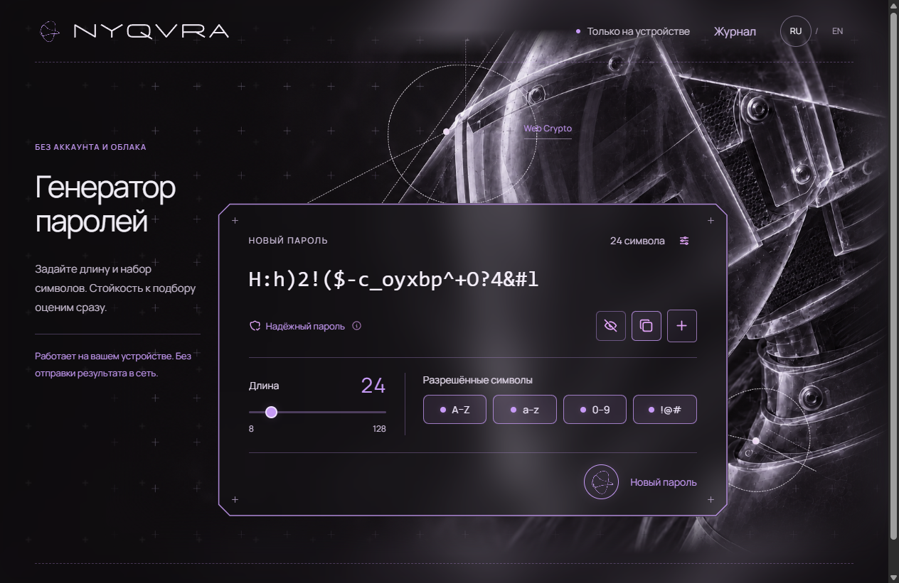
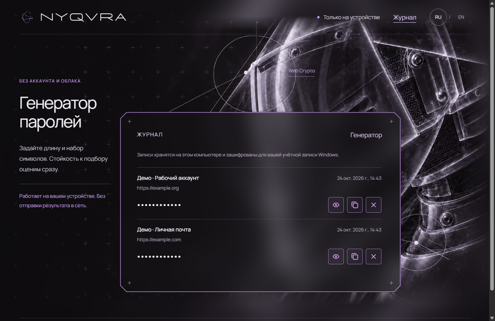

# NYQVRA

[English](README.md) · **Русский**

Создавайте случайные пароли и фразы локально. Смотрите их стойкость к подбору — без аккаунта и отправки результата на сервер.

**[Открыть NYQVRA](https://dianadorozhai.github.io/nyqvra/)** · **[Скачать для Windows или браузера](https://github.com/DianaDorozhAI/nyqvra/releases/tag/v0.3.0)** · [Продуктовый кейс](docs/CASE-STUDY.md)

## Возможности

- Комбинации длиной **8–128 символов** с выбором букв, цифр и специальных знаков.
- Фразы из **4–10 английских слов** списка EFF Large Wordlist.
- Понятная оценка стойкости и объяснение для **трёх условий подбора**.
- Сохранение текущего результата при настройке: он заменяется только после новой генерации.
- Копирование, скрытие и интерфейс на **русском и английском**.

NYQVRA связывает генерацию с объяснением того, что меняют настройки. Это отдельный генератор, а не менеджер паролей, сервис проверки утечек или гарантия безопасности аккаунта.

## Как пользоваться

### На сайте

[Откройте приложение](https://dianadorozhai.github.io/nyqvra/), задайте параметры, сгенерируйте и скопируйте результат. Установка не нужна. Сохраните его в выбранном менеджере паролей: в NYQVRA нет истории и восстановления.

### Windows-приложение — 0.3.0

Скачайте **[установщик Windows x64 — 0.3.0](https://github.com/DianaDorozhAI/nyqvra/releases/tag/v0.3.0)**. Файл `NYQVRA-0.3.0-Windows-x64-Setup.exe` устанавливает приложение с иконкой NYQVRA и ярлыками. В мастере можно выбрать русский или английский язык.

В приложении можно явно сохранить выбранный результат, указав название аккаунта, комментарий или ссылку. Вкладка «Журнал» показывает дату и подпись; значение скрыто до нажатия «Показать», доступны копирование и удаление. Все генерации автоматически не записываются.

Журнал зашифрован средствами Windows для текущей учётной записи и хранится только на этом компьютере. Облачной синхронизации, мастер-пароля и восстановления на другом компьютере нет. Шифрование не защищает от вредоносных программ, работающих от вашего имени. Удаление приложения не удаляет журнал автоматически.

Установщик пока не подписан сертификатом издателя: Windows может показывать предупреждение. Не отключайте защиту Windows. Независимый аудит не проводился. Веб-версия и браузерный офлайн-архив по-прежнему не сохраняют результаты.

### Браузерный офлайн-архив — 0.3.0

1. Скачайте **`NYQVRA-0.3.0-offline.zip`** из [релиза 0.3.0](https://github.com/DianaDorozhAI/nyqvra/releases/tag/v0.3.0).
2. Распакуйте **весь** архив.
3. Откройте **`index.html`** в современном браузере. Интернет, Node.js и установка не нужны.

Это локальное веб-приложение, не Windows .exe и не устанавливаемая PWA. Если браузер запрещает доступ к буферу из локального файла, выделите результат и скопируйте вручную. [Инструкция офлайн-запуска](docs/OFFLINE.txt).

Рядом с архивом есть **SHA256SUMS.txt**. Сверить сумму можно через `Get-FileHash` в Windows или `sha256sum` в Linux. Совпадение подтверждает целостность относительно доверенного файла, а не отсутствие уязвимостей.

## Приватность и оценка стойкости

Генерация использует **Web Crypto** и выбор без смещения. Ресурсы включены в сборку; нет запросов к API и аналитики. Веб-версия не хранит созданные результаты; Windows-версия сохраняет их только по явному действию пользователя. Хостинг сайта обрабатывает обычные запросы загрузки страницы и ресурсов.

Оценка относится к подбору результатов NYQVRA, а не к фишингу, вредоносному ПО, повторному использованию или взлому устройства и сервиса. Предположения и пороги описаны в [методике](docs/SECURITY-MODEL.md). **Независимый аудит безопасности пока не проводился.** У памяти страницы, истории и синхронизации буфера есть ограничения — подробнее в [документе по безопасности](SECURITY.md).

## Документация

- [Продуктовый кейс](docs/CASE-STUDY.md): задача, аудитория, аналоги, решения, сценарий и результаты.
- [Методика оценки](docs/SECURITY-MODEL.md): формулы, скорости и пороги.
- [Сборка и тесты](docs/DEVELOPMENT.md): локальный запуск, структура и упаковка.
- [История версий](CHANGELOG.md) и [объём проверки](docs/QA.md).

Набор из 24 автоматических проверок включает хранилище и ограничения настольного приложения; CI запускает его на Windows/Linux с Node.js 22/24. Отдельный Windows workflow проверяет генерацию, RU/EN, сохранение через интерфейс, шифрование, копирование и удаление, затем собирает установщик. Текущий статус виден в результатах workflow. Это регрессионные тесты, не сертификация безопасности.

## Лицензия и автор

Автор — [Диана / DianaDorozhAI](https://github.com/DianaDorozhAI). Собственные материалы проекта доступны по **[открытой лицензии MIT](LICENSE)**: их можно использовать, изменять и распространять, в том числе коммерчески, сохраняя уведомление об авторстве и текст лицензии. Они предоставляются без гарантий; изменённые версии не подразумевают одобрения автора.

MIT охватывает собственный код, документацию и визуальные материалы в пределах прав автора. Сторонние условия сохраняются отдельно: **EFF — CC BY 3.0 US; Tabler Icons — MIT; Manrope — SIL OFL 1.1**. Полная атрибуция: [THIRD_PARTY_NOTICES.md](THIRD_PARTY_NOTICES.md). LICENSE и уведомления входят в офлайн-архив.
