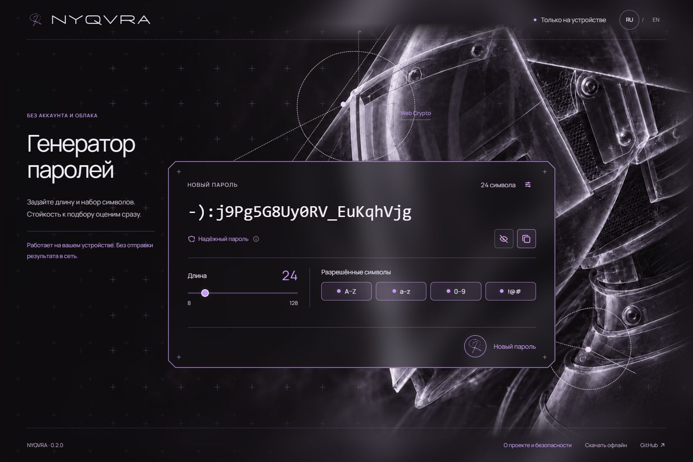

# NYQVRA: от генерации к понятной оценке стойкости

[English](CASE-STUDY.en.md) · **Русский**

NYQVRA — небольшой инструмент, который создаёт случайные пароли локально и помогает разобраться, как выбранные настройки влияют на их устойчивость к подбору. Проект прошёл путь от концепции до опубликованного веб-приложения, автономного архива и открытого репозитория.

**Автор продукта — Диана / [DianaDorozhAI](https://github.com/DianaDorozhAI).** Работа включала постановку задачи, анализ аналогов, проектирование сценария, интерфейс, реализацию и подготовку релиза. Код и документация разрабатывались с помощью ИИ-инструментов; продуктовые и визуальные решения уточнялись в последовательных итерациях.

[Открыть приложение](https://dianadorozhai.github.io/nyqvra/) · [Скачать офлайн](https://github.com/DianaDorozhAI/nyqvra/releases/latest) · [Исходный код](https://github.com/DianaDorozhAI/nyqvra)

## 1. Проблема и продуктовая гипотеза

Сгенерировать случайную строку уже умеют браузеры и менеджеры паролей. Поэтому ценность нового инструмента нельзя обосновать только длиной результата или обещанием «невозможно взломать».

Для NYQVRA была выбрана более узкая задача: связать генерацию с понятным объяснением стойкости. Пользователь задаёт ограничения, получает результат и видит, как его оценка зависит от условий подбора. При этом ему не нужно читать формулы, регистрироваться или передавать созданную строку отдельному сервису проверки.

**Гипотеза:** краткая оценка рядом с результатом и объяснение по запросу позволят принимать более осмысленное решение о длине и формате, чем изолированная метка «сильный пароль». Это направление проектирования, а не доказанный результат пользовательского исследования.

## 2. Для кого и для какого момента

Основной сценарий — человек создаёт новый аккаунт или меняет учётные данные и хочет быстро получить уникальную комбинацию под требования сервиса.

При проектировании учитывались три потребности:

- **Быстро получить результат.** Без установки и предварительной настройки инструмента.
- **Разобраться в оценке.** Понять, почему изменение длины или формата имеет значение, не становясь специалистом по криптографии.
- **Работать автономно.** Иметь скачиваемую копию, которой не требуется подключение к сайту.

Эта аудитория сформулирована как проектная гипотеза. Интервью и сегментация на основе реального использования пока не проводились.

## 3. Что показал разбор аналогов

Сравнивались публичные описания продуктов и способы их распространения, а не заявленная «сила» алгоритмов.

| Пример | Наблюдение | Решение для NYQVRA |
| --- | --- | --- |
| [Homelab Vault](https://github.com/jakubgt/homelab-vault-gen) | Браузерный инструмент с автономной загрузкой и отдельной документацией по безопасности | Совместить быстрый веб-доступ с готовым офлайн-архивом |
| [Offline Password Generator](https://github.com/spidersalt/offline-password-generator) | Автономный запуск через распакованный HTML | Не заставлять пользователя собирать исходники ради локального запуска |
| [KeePassXC](https://github.com/keepassxreboot/keepassxc) | Настольный менеджер с генератором как частью более широкого продукта | Не пытаться в первом релизе заменить менеджер паролей |

Вывод был не в том, чтобы повторить больше функций. Базовые криптографические механизмы уже доступны другим инструментам. Отличие NYQVRA сформулировано через сценарий: **создать локально → понять оценку → скопировать результат**.

## 4. Как определили границы первого релиза

В первоначальной концепции рассматривался более широкий инструмент анализа безопасности. По мере проработки стало ясно, что отдельная проверка произвольных паролей усложняет и интерфейс, и объяснение результата: для случайно сгенерированной строки и человеческого шаблона нужны разные предположения.

Поэтому первый релиз сосредоточен на собственных результатах генератора:

- случайные комбинации длиной 8–128 символов;
- фразы из 4–10 английских слов;
- выбор разрешённых наборов и дополнительное требование включать каждый из них;
- оценка стойкости и три сценария подбора;
- веб-версия и автономная загрузка.

Хранилище, история, анализ введённых пользователем строк и проверка утечек не вошли в этот объём. Такое ограничение делает назначение продукта понятнее и позволяет объяснять расчёт на известных предпосылках.

## 5. Основной пользовательский сценарий

1. При открытии приложения уже есть сгенерированный результат.
2. Пользователь задаёт длину и набор символов либо выбирает формат фразы.
3. Изменение настроек не стирает текущую строку. Она заменяется только после явной генерации.
4. Рядом появляется краткая оценка: высокая, средняя или низкая стойкость к подбору.
5. Нажатие на оценку открывает объяснение и сравнение условий атаки.
6. Пользователь копирует результат и сохраняет его в выбранном менеджере паролей.

Сохранение старого результата при настройке — важная деталь сценария: человек может экспериментировать с параметрами, не теряя уже созданную комбинацию до принятия решения.

## 6. Как упростили объяснение безопасности

Ранний вариант показывал энтропию, огромные сроки перебора, скорости проверки и формулы. Это объясняло устройство модели, но отодвигало основной вопрос пользователя: «Как мне оценить этот результат?»

Информация была разделена на три уровня:

| Уровень | Содержание | Зачем |
| --- | --- | --- |
| Главный экран | Краткая оценка рядом с результатом | Быстро понять, нужно ли усилить параметры |
| Объяснение по запросу | Условия подбора и их относительная оценка | Увидеть, почему один результат оценивается по-разному |
| Документация | Формулы, скорости, пороги и ограничения | Дать возможность проверить методику без перегрузки интерфейса |

Отдельные строки «Надёжный пароль» и «Почему такая оценка?» были объединены в одно действие. Скрытие и копирование размещены рядом и оформлены как иконки с доступными названиями. Вместо отдельной «проверки нового пароля» объяснение относится непосредственно к уже показанному результату.

## 7. Почему локальность стала архитектурным решением

Заявление о локальной генерации должно подтверждаться устройством продукта. В NYQVRA нет сервера обработки результатов: случайные значения предоставляет Web Crypto, список слов и остальные ресурсы входят в сборку. При выборе индекса используется отбрасывание лишних значений, чтобы избежать смещения.

Для сайта это означает генерацию в браузере после загрузки приложения. Для автономного сценария тот же интерфейс упакован в папку с HTML и ресурсами. Скачивание не требует установки отдельной среды разработки.

Выбранный формат снижает сложность поставки первого релиза: одно ядро используется в двух способах доступа. Нативный установщик пока не добавляет отдельной пользовательской возможности, которая оправдала бы его поддержку.

## 8. Роль интерфейса

Визуальная задача заключалась в том, чтобы сделать технический инструмент узнаваемым, сохранив фокус на результате. Поэтому главный экран организован вокруг одной рабочей области: результат, его оценка, параметры и повторная генерация.

Во время итераций уточнялись читаемость, размещение действий, количество пояснений и поведение длинных строк. Дополнительные настройки вынесены из основного сценария. Адаптивная раскладка должна сохранять доступность управления, а не просто уменьшать весь экран.

Визуальный образ поддерживает идентичность продукта, но не используется как доказательство безопасности. Детали оформления не подменяют продуктовую ценность и проверяемость реализации.

## 9. Что получилось и как это проверено

К первому публичному релизу подготовлены работающий сайт, автономный ZIP, репозиторий, инструкции RU/EN и документация по методике. В версии 0.2.1 добавлена лицензия MIT с сохранением отдельных условий сторонних материалов.

Проверки включают:

- 19 автоматических тестов: генерация, ограничения, расчёты, список слов, сборка и упаковка;
- успешные запуски CI на Windows и Linux с Node.js 22/24;
- браузерную проверку основных действий и интерфейса на разных ширинах;
- проверку слабых, средних и сильных результатов вместо одинаковой положительной метки;
- контроль состава архива и SHA-256 скачанного релиза.

Это подтверждает готовность конкретной реализации в проверенных условиях, но не доказывает удобство для всей аудитории или отсутствие любых уязвимостей. Независимого аудита, исследований с участниками и подтверждённых бизнес-метрик пока нет. Проверка автономного запуска в разных браузерах остаётся отдельной задачей.

## 10. Следующий шаг

Следующий этап — проверить основную гипотезу на реальных задачах: понимает ли человек оценку, замечает ли изменение параметров и может ли без подсказки перейти от генерации к сохранению результата.

Для такой проверки подходят время выполнения задания, ошибки в сценарии и способность объяснить оценку своими словами. Это **план измерения**, а не уже достигнутые показатели. Отдельное направление — независимое ревью генерации, модели и цепочки поставки.

**Главный результат кейса:** из идеи «ещё одного генератора» сформирован ограниченный, работающий продукт с объяснимой оценкой и двумя способами доступа. Дальнейшее развитие должно опираться на проверку этой ценности, а не на количество дополнительных функций.
